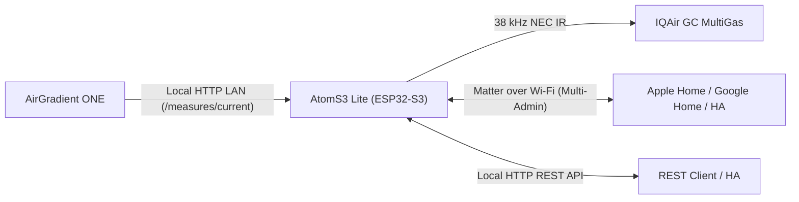

# IQAir Controller: Project Context

## Goal

Firmware for an **M5Stack AtomS3 Lite** (ESP32-S3) that:

1. Reads air quality from an **AirGradient ONE** monitor over its local LAN HTTP
   API (`/measures/current`).
2. Decides on a purifier fan level from those readings using an autonomous
   on-device control policy.
3. Drives an **IQAir GC MultiGas** purifier by sending discrete 38 kHz NEC
   infrared commands from the AtomS3 Lite's built-in IR LED.
4. Integrates with **Apple Home, Google Home (and Home Assistant via Multi-Admin)**
   over **Matter over Wi-Fi**, and exposes an authenticated local **HTTP REST API**
   for configuration and diagnostics.

## Project phase

**No physical AtomS3 Lite yet.** Until it arrives, verification happens in
simulation (Wokwi) and in host unit tests. See the `wokwi-simulation` skill.

**Phase 2 (current, since 2026-11-09): implementation.** The firmware lives at the
repo root (`platformio.ini`, `src/`, `include/`, `test/`). Build with
`~/.platformio/penv/bin/pio run -e atoms3`; host tests with `pio test -e native`.
The pioarduino platform's install hook may replace PlatformIO with
`pioarduino 6.2.0.post1`, which the platform then rejects. If that happens:
`~/.platformio/penv/bin/python -m pip uninstall -y pioarduino && ~/.platformio/penv/bin/python -m pip install --force-reinstall platformio==6.2.0`.

## Hardware facts (verified, don't guess)

| Item | Value |
| :--- | :--- |
| MCU | ESP32-S3FN8, 8 MB flash, **no PSRAM**, 2.4 GHz WiFi only |
| IR transmitter | **GPIO4**. It only transmits; the board has **no IR receiver** |
| RGB LED (WS2812) | **GPIO35** |
| Button | **GPIO41** (active low) |
| Grove Port A | G1 / G2 (I2C or plain GPIO) |
| Bottom headers | G5, G6, G7, G8, G38, G39, plus 3V3, 5V, GND |
| USB | Native USB-CDC (VID 0x303A). Port shows as `/dev/cu.usbmodem*` |
| PlatformIO board id | `m5stack-atoms3` (there's no separate "lite" board) |

Pins were checked against the M5Unified board tables and M5Stack's AtomS3 IR example.

## Purifier facts: IQAir GC MultiGas

- HEPA plus a large activated-carbon/gas stage.
- IR protocol: **NEC, address 0x00**. Discrete codes for speeds 1–6 and Off.
  There's **no power-on code**. Codes are cross-verified against two sources
  but **not yet tested on hardware**. Details:
  `.agents/skills/ir-code-capture/references/iqair_gc_multigas.md`.

## Requirements

**Requirements live in `docs/main_requirement_spec.md` (firmware SRS) and
`docs/automated_iaq_multigas_fan_controller_spec_v3.md` (control algorithm)**, the
sources of truth, revised independently. Read them before any work on behaviour. Don't copy requirement values into
this file or into skills. If the spec is silent or ambiguous, ask the user, and the
answer goes into the spec.

## Architecture decisions

| Date | Decision |
| :--- | :--- |
| 2026-11-06 | Simulator: Wokwi (`wokwi-cli`) for whole-firmware runs, plus PlatformIO `native` unit tests for logic |
| 2026-11-06 | The control policy runs **on the AtomS3** (autonomous; works without Home Assistant) |
| 2026-11-06 | ~~HA integration path: MQTT discovery (deferred)~~ **Superseded 2026-11-09** |
| 2026-11-09 | Smart home: **Matter over Wi-Fi (Multi-Admin)** for Apple Home + Google Home (+ HA later), plus a local REST API (SRS v2.0) |
| 2026-11-09 | Toolchain: PlatformIO + **pioarduino 55.03.312-1** (Arduino-ESP32 3.3.12, ESP-IDF 5.5.5) |
| 2026-11-09 | AirGradient data source: **local API only** (`/measures/current`, 4-step discovery) |
| 2026-11-09 | Network watchdog: **spec v3 §3.1 speed caps**; the SRS unreachable alarm is notification only (SRS §3.1) |
| 2026-11-09 | REST auth: **button-initiated pairing → per-device bearer token** for mutating endpoints; GETs open (SRS §5.3) |
| 2026-11-09 | Frozen AirGradient readings: stale warning first, then **counted as failed polls** (SRS §3.1 rule 5) |

## Open decisions

- How the simulation build gets air-quality data (serial injection, or a mock server via
  the paid Private Gateway), and which Wokwi plan to use. Wokwi has no Bluetooth, so
  Matter BLE commissioning can't be simulated.

## Skills: load the matching one before starting a task

| Task | Skill |
| :--- | :--- |
| Build, flash, monitor serial, debug crashes | `atoms3-platformio-workflow` |
| Simulate firmware (no hardware yet), scenarios, IR waveform checks, mock API | `wokwi-simulation` |
| AirGradient API, tokens, fields, polling | `airgradient-api` |
| WiFi, reconnects, HTTPS certificates, NTP, mDNS | `esp32-wifi-tls` |
| Learning, importing, or verifying purifier IR codes | `ir-code-capture` |
| Sending IR, purifier state model, pacing, resync | `purifier-ir-control` |
| AQI math, thresholds, hysteresis, fail-safe | `air-quality-control-logic` |
| Smart home (Matter Multi-Admin, EP1–EP3, Home Assistant inspection) | `matter-smart-home` |
| Over-the-air firmware updates (dual-OTA layout, auth, rollback) | `esp32-ota-updates` |
| Device settings API, validation, auth, NVS, provisioning | `device-config-api` |

Use the `firmware-reviewer` subagent to review code before flashing.

## Golden rules

- Don't put secrets (WiFi password, AirGradient token) in tracked files.
- Don't flash, erase, or write to serial ports without telling the user first.
  Hardware is physically attached.
- The main loop must stay non-blocking.
- If air-quality data is missing, unparseable, or stale, the firmware must not
  send IR commands based on it, except for fail-safe actions the spec explicitly defines.
