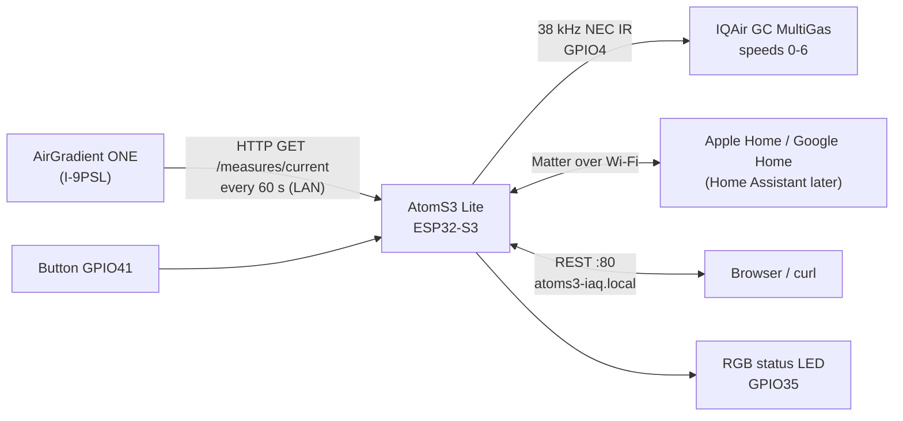

# AtomS3 IAQ Purifier Controller

Firmware for an **M5Stack AtomS3 Lite** (ESP32-S3) that reads an **AirGradient ONE**
indoor air-quality monitor over the local network, runs the
**v3.0 dual-path (PM2.5 + TVOC/NOx) control algorithm**, and drives an
**IQAir GC MultiGas** air purifier (speeds 0–6) with discrete infrared commands.
The device appears in **Apple Home and Google Home through Matter over Wi-Fi**
(Multi-Admin), and has a **local REST API** for settings and diagnostics.

> [!NOTE]
> **Project status: hardware verified.** The firmware is tested on physical hardware
> (M5Stack AtomS3 Lite controlling an IQAir GC MultiGas purifier with local AirGradient ONE
> polling). **Apple HomeKit integration is tested and verified** to work as expected.
> **Google Home (Android)** has not yet been physically verified (see [Known limitations](#known-limitations)).

---

## Table of contents

- [How it works](#how-it-works)
- [Hardware](#hardware)
- [Installation (firmware update)](#installation-firmware-update)
- [First boot and pairing](#first-boot-and-pairing)
- [Operation](#operation)
  - [Operating modes](#operating-modes)
  - [Button](#button)
  - [Status LED](#status-led)
  - [Web dashboard](#web-dashboard)
  - [Apple Home and Google Home (Matter)](#apple-home-and-google-home-matter)
  - [REST API](#rest-api)
  - [Configuration reference](#configuration-reference)
- [Control behaviour](#control-behaviour)
- [Development](#development)
- [Troubleshooting](#troubleshooting)
- [Known limitations](#known-limitations)
- [Repository layout](#repository-layout)

---

## How it works



1. Every 60 s the AtomS3 reads PM2.5, TVOC index, NOx index, CO₂, temperature and
   humidity from the AirGradient's **local** API. No cloud account or token is needed.
2. A 5-minute moving average feeds two control paths. **PM2.5** drives speeds 0–6,
   and **TVOC/NOx** set a capped "gas floor". The higher target wins. Speed goes up
   immediately and comes down slowly. Day and night use different thresholds.
3. When the target speed changes, the matching IQAir remote code is sent over IR.
4. Apple Home and Google Home show an Air Purifier tile (Auto/Manual, speed slider) and
   an air quality + temperature + humidity sensor.

The full requirements are in [`docs/main_requirement_spec.md`](docs/main_requirement_spec.md)
(firmware SRS) and [`docs/automated_iaq_multigas_fan_controller_spec_v3.md`](docs/automated_iaq_multigas_fan_controller_spec_v3.md)
(control algorithm).

---

## Hardware

| Item | Notes |
| :--- | :--- |
| [M5Stack AtomS3 Lite](https://docs.m5stack.com/en/core/AtomS3%20Lite) | ESP32-S3FN8, 8 MB flash, no PSRAM, built-in IR LED (GPIO4), RGB LED (GPIO35), button (GPIO41) |
| [AirGradient ONE](https://www.airgradient.com/) (I-9PSL) | Firmware with the local API (`/measures/current`), on the same LAN and Wi-Fi as the AtomS3 |
| IQAir GC MultiGas | Controlled with its discrete NEC IR codes (address 0x00) |
| USB-C data cable | For flashing and serial logs |
| 2.4 GHz Wi-Fi | The ESP32-S3 has no 5 GHz radio |

**Placement:** the built-in IR LED is weak. Put the AtomS3 **within about 1–2 m of the
purifier's IR window, with a clear line of sight**. The spec recommends keeping the
AirGradient **2.5–3 m away** from the purifier's outlet.

---

## Installation (firmware update)

Initial firmware is installed over USB with [PlatformIO](https://platformio.org/). Subsequent
updates can be pushed over the LAN with authenticated HTTP OTA (`POST /api/v1/ota`),
using the partition table's two 3.5 MB OTA slots with bootloader rollback protection
(the new image cancels rollback only after storage, IR, and Matter initialize).

### 1. Manual prerequisites & toolchain setup (once per machine)

#### Manual prerequisites

Install these host dependencies using your OS package manager before bootstrapping:

| Dependency | Needed for | Manual install |
| :--- | :--- | :--- |
| **Git & curl** | Cloning and fetching toolchain installers | OS package manager (`apt install git curl`, Homebrew, etc.) |
| **Host C++ compiler (`g++` / `clang++`)** | Running host unit tests (`pio test -e native`) | Ubuntu/Debian: `sudo apt-get install build-essential`<br>macOS: `xcode-select --install`<br>Windows: WSL2 (recommended) or MSYS2 MinGW-w64 |
| **Python >= 3.10** | PlatformIO Core + **pioarduino** (Arduino-ESP32 `3.3.12` / ESP-IDF `5.5.5` for Matter) | System Python >= 3.10, or `uv` (see command block below) |
| **Linux USB serial udev rules** *(hardware flashing only)* | Accessing `/dev/ttyACM*` (ESP32-S3 native USB-CDC, VID `0x303A`) without `sudo` | Add user to `dialout` + install PlatformIO udev rules (see command block below) |
| **`wokwi-cli` + `WOKWI_CLI_TOKEN`** *(optional, simulation only)* | Running live Wokwi hardware simulations in `sim/scenarios/` | Install `wokwi-cli` (command below) + add `WOKWI_CLI_TOKEN` from [Wokwi CI](https://wokwi.com/dashboard/ci) to `.env` |

Optional helper commands for the manual prerequisites above:

```bash
# Python 3.12 without admin rights (if your system Python is older than 3.10)
curl -LsSf https://astral.sh/uv/install.sh | sh
~/.local/bin/uv python install 3.12

# Linux USB serial permissions (log out and back in after adding dialout)
sudo usermod -aG dialout "$USER"
curl -fsSL https://raw.githubusercontent.com/platformio/platformio-core/develop/platformio/assets/system/99-platformio-udev.rules \
  | sudo tee /etc/udev/rules.d/99-platformio-udev.rules >/dev/null
sudo udevadm control --reload-rules && sudo udevadm trigger

# Optional Wokwi CLI (only if running live simulations)
curl -L https://wokwi.com/ci/install.sh | sh
```

> [!NOTE]
> All firmware library dependencies (`ArduinoJson@7.4.2`, Unity test framework, Arduino-ESP32 Matter stack, and Xtensa ESP-IDF toolchains) are pinned in [`platformio.ini`](platformio.ini) and downloaded automatically by PlatformIO. Python helper scripts in `.agents/` use only the Python standard library (plus `pyserial`, which PlatformIO bundles in `~/.platformio/penv`).

#### Automated bootstrap (PlatformIO + project dependencies)

Clone the repository and run the idempotent bootstrap script:

```bash
git clone <repository-url> && cd iqair-controller
./scripts/bootstrap.sh          # installs PlatformIO 6.2.0, project deps, and runs native tests
./scripts/bootstrap.sh --build  # also compiles atoms3, atoms3_debug, and atoms3_sim (~2.5 GB download on first run)
export PATH="$HOME/.platformio/penv/bin:$PATH"
```

If you prefer installing PlatformIO manually instead of `./scripts/bootstrap.sh`:

```bash
curl -fsSL -o get-platformio.py https://raw.githubusercontent.com/platformio/platformio-core-installer/master/get-platformio.py
python3 get-platformio.py   # must be Python >= 3.10
export PATH="$HOME/.platformio/penv/bin:$PATH"
pio --version
```

> [!NOTE]
> The pioarduino platform's install hook can replace PlatformIO with
> `pioarduino 6.2.0.post1`. The platform then rejects it with
> *"not compatible with PlatformIO Core v6.2.0-post.1"*. `./scripts/bootstrap.sh`
> handles this automatically; if you hit it manually, run:
> ```bash
> ~/.platformio/penv/bin/python -m pip uninstall -y pioarduino
> ~/.platformio/penv/bin/python -m pip install --force-reinstall platformio==6.2.0
> ```

#### Optional local templates (never committed)

- **Bench Wi-Fi credentials** *(not needed for Matter BLE commissioning)*: `cp include/secrets.h.example include/secrets.h`
- **Host CLI tokens** *(Wokwi / AirGradient Cloud / Home Assistant helper scripts)*: `cp .env.example .env`

### 2. Build & run unit tests

```bash
pio test -e native         # host unit tests (no hardware required)
pio run -e atoms3          # build firmware (add PLATFORMIO_OFFLINE=1 once cached to skip network checks)
```

A successful firmware build ends with `[SUCCESS]` and reports about 44% RAM and ~1.95 MB flash.

### 3. Flash

1. Connect the AtomS3 Lite over USB-C. It appears as `/dev/cu.usbmodem*` (macOS)
   or `/dev/ttyACM*` (Linux).
2. Flash the firmware:
   ```bash
   pio run -e atoms3 -t upload
   ```
3. Optional: upload the default configuration file to LittleFS. The same defaults are
   compiled into the firmware, so this step is only needed if you edit `data/config.json`
   before the first boot:
   ```bash
   pio run -e atoms3 -t uploadfs
   ```

**If the upload fails** (`Failed to connect` / `No serial data received`), put the board in
**download mode**: unplug it, hold the button, plug it in, and release after about 2 s.
Retry the upload, then unplug and replug to start the new firmware.

> [!TIP]
> To start completely fresh (erase Matter pairings, Wi-Fi and settings), run
> `pio run -e atoms3 -t erase` before uploading.

### 4. Updating later

- **Over USB:** Repeat steps 2–3. Settings (NVS) and Matter pairings survive a normal firmware upload.
- **Over HTTP OTA (once paired):**
  ```bash
  pio run -e atoms3
  curl -s -X POST http://atoms3-iaq.local/api/v1/ota \
       -H "Authorization: Bearer $IAQ_TOKEN" \
       -H "Content-Type: application/octet-stream" \
       --data-binary @.pio/build/atoms3/firmware.bin
  # {"status":"ok","rebooting":true}
  ```

---

## First boot and pairing

1. Open the serial monitor (115200 baud):
   ```bash
   pio device monitor -e atoms3
   ```
2. On an unpaired device, the boot log prints the Matter pairing details:
   ```text
   ==== Matter commissioning (Apple Home / Google Home) ====
   Manual pairing code: 3497-011-2332
   QR code URL:         https://project-chip.github.io/connectedhomeip/qrcode.html?data=MT:...
   ```
   The LED **pulses magenta** while it waits to be paired.
3. **Apple Home:** *Add Accessory* → scan the QR code (open the URL) or enter the manual code.
   The phone sends your Wi-Fi credentials to the device over Bluetooth. The firmware has
   no hard-coded Wi-Fi credentials.
4. **Google Home (Multi-Admin):** in Apple Home, open the accessory → *Turn On Pairing Mode*,
   then add it in Google Home with the new code. Home Assistant can be added the same way later.
5. Once connected, the device:
   - frees its Bluetooth memory;
   - syncs the clock;
   - finds the AirGradient (see [discovery](#airgradient-discovery));
   - starts the REST API at `http://atoms3-iaq.local` (read-only until you
     [pair a REST client](#pairing-a-rest-client)).

> [!NOTE]
> The firmware uses the Arduino Matter library's default **test commissioning credentials**,
> so Apple and Google Home will warn about an *uncertified accessory*. That's expected for
> DIY Matter devices. Accept the warning to continue.

**Development or simulation only:** if you create a gitignored `include/secrets.h` with
`#define WIFI_SSID "..."` and `#define WIFI_PASSWORD "..."`, the device joins that network
at boot. Matter can then be commissioned over the network. Never commit this file.

### AirGradient discovery

The AirGradient is located automatically, in this order:

1. `ag_target_host` (a static IP or hostname), if configured
2. the cached IP from the last successful poll
3. mDNS host `airgradient_<ag_serial>.local` (default serial `9888e0eefcec`)
4. an mDNS service scan (`_airgradient._tcp`, then `_http._tcp`), accepting only devices
   whose JSON `serialno` matches

If your network blocks mDNS, set `ag_target_host` to the monitor's IP address.

---

## Operation

### Operating modes

| Mode | Behaviour |
| :--- | :--- |
| **AUTO** (default) | The v3.0 algorithm sets the speed from the air readings and the day/night schedule |
| **MANUAL** | Holds a fixed speed 0–6 until you switch back to Auto, or until `manual_timeout_mins` expires (0 = never). Polling continues so the averages stay current |
| **NIGHT_FORCE** | Like AUTO, but always uses the quieter night thresholds. Set via the REST API (`operating_mode: "night_force"` or `set_speed` with `mode: "night_force"`) |

Manual overrides take precedence over automatic control. They come from the Apple/Google
Home slider, the REST API, or the button.

### Button

| Press | Action |
| :--- | :--- |
| **Short** (< 1 s) | Cycle AUTO → MANUAL 1 → MANUAL 2 → MANUAL 3 → MANUAL Off → AUTO |
| **Hold 3–10 s, then release** | Opens **REST API pairing mode** for 60 s (see [Pairing a REST client](#pairing-a-rest-client)). The LED turns solid cyan at 3 s ("release now"), then shows a cyan heartbeat while pairing is open |
| **Long** (≥ 10 s) | The LED blinks magenta rapidly. After 2 s the Matter pairings **and the REST API token** are erased and the device restarts in pairing mode |

Releases between 1 and 3 s are ignored. There's no button gesture to re-send the IR
code any more: the device re-sends it every 15 min, and `test_ir` does it on demand.

### Status LED

The highest-priority active state is shown. At night (23:00–07:59, or when `NIGHT_FORCE`
is active) the normal states P5–P8 are **off**, unless `night_led_enabled` is set
(then they show at a quarter of their day brightness). Faults and warnings always show.

| Priority | State | Colour / pattern | Day / night brightness |
| :--- | :--- | :--- | :--- |
| – | Factory-reset warning (long press) | Magenta, rapid 10 Hz | 100% |
| – | Button held 3–10 s: release now to pair | Cyan, solid | 80% / 40% |
| – | REST API pairing mode (60 s) | Cyan heartbeat (double blink each second) | 80% / 40% |
| P1 | AirGradient unreachable ≥ 5 min (speed per the watchdog caps) | Red, 3 Hz strobe | 80% / 40% |
| P2 | Not paired with Matter | Magenta, 1 Hz pulse | 60% / 20% |
| P2 | Wi-Fi disconnected | Blue, 2 Hz blink | 60% / 20% |
| P3 | AirGradient poll failing for 1–4 min (speed held, or capped at night) | Amber / Yellow-Orange (`#FFAA00`), 1 Hz pulse (500 ms on / off) | 50% / 15% |
| P4 | IR command sent | White, double flash | 70% / 10% |
| P5 | Manual override active | Purple, slow breathing | 40% / off |
| P6 | Auto, speeds 4–6 | Orange-red, solid | 40% / off |
| P7 | Auto, speeds 2–3 | Cyan, solid | 30% / off |
| P8 | Auto, speeds 0–1 | Emerald green, solid | 20% / off |

> [!TIP]
> **Intermittent Yellow/Orange (Amber) blinking:** If the LED alternates between solid
> cyan (speeds 2–3) or green (speeds 0–1) and pulsing yellow/orange, the AtomS3 is experiencing
> temporary HTTP/Wi-Fi timeouts communicating with the AirGradient monitor. The controller holds
> its speed and retries up to 3 times per poll with exponential backoff; when a poll succeeds,
> the LED returns to normal solid cyan/green.

### Web dashboard

A lightweight, zero-dependency HTML dashboard is built into the firmware and served directly
at `http://atoms3-iaq.local/` (or the device IP) on port 80. You can bookmark and open it in any
desktop or mobile browser without issuing CLI or `curl` commands:

- **Live purifier status:** Commanded speed (0–6), operating mode (Auto, Manual, Night Force),
  and dominant decision trigger (`pm25`, `gas`, `manual`, or `none`).
- **AirGradient health:** Reachability (`online`, `degraded`, `unreachable_alarm`), failed poll counter,
  and monitor freeze/stale detection.
- **Environmental readings:** PM2.5 (instant & 5-min SMA), TVOC index, NOx index, CO₂ (ppm),
  temperature (°C), and relative humidity (%).
- **System diagnostics:** Free heap & minimum historical free heap (tracking SRAM margin),
  uptime, Wi-Fi RSSI signal strength (dBm), total IR command frames transmitted, and running
  **firmware version & build SHA** in the footer (auto-updated across OTA reboots).
- **Recent activity log:** Real-time log of the last 24 system events (speed transitions, mode
  changes, sensor alarms, and watchdog caps) with auto-refresh every 5 seconds.

### Apple Home and Google Home (Matter)

The AtomS3 acts as a native Matter over Wi-Fi bridge exposing a composite device:

| Accessory | What you can do |
| :--- | :--- |
| **Air Purifier** (`0x002D`) | On/Off toggle, **Auto** vs **Manual** mode, and discrete 6-step speed slider (≈ 17% per speed). |
| **Air quality sensor** (`0x002C`) | Air quality rating (EPA PM2.5-aligned), PM2.5 (µg/m³), CO₂ (ppm), TVOC and NO₂ levels (low to critical), temperature, and humidity. Sets a Matter fault alarm if the monitor is unreachable for ≥ 5 min. |

Speed mapping: Off = 0%, Speed 1 = 17%, Speed 2 = 33%, Speed 3 = 50%, Speed 4 = 67%, Speed 5 = 83%, Speed 6 = 100%.

**Hardware verification & controller support:**
- **Apple Home (iOS / macOS / HomePod): Verified on hardware.**
  - **Auto ↔ Manual mode toggling:** Switching between Auto and Manual modes updates smoothly.
    A genuine tap from Auto to Manual automatically resumes the **current running speed** (if running)
    or the **last non-zero speed** (rather than jumping to 100%).
  - **Coalesced write handling:** Apple Home sends a rapid two-write sequence (`FanMode = High` followed
    ~38 ms later by `FanMode = Auto`) when turning on into Auto. The firmware defers the High write by
    120 ms, absorbing the burst cleanly without spurious fan revs or state snapbacks.
  - **Smooth slider interaction:** Dragging the manual speed slider does not overwrite the user's
    target percentage while dragging, updating `PercentCurrent` to quantized discrete steps.
- **Google Home (Android): Remaining known testing item.**
  - The firmware exposes standard Matter clusters compatible with Google Home via Matter Multi-Admin,
    but physical verification with an active Google Nest / Home hub has not yet been performed.

### REST API

Base URL: `http://atoms3-iaq.local` (or the device's IP), port 80, JSON.

Reading (`GET`) is open on your LAN. Anything that **changes** the device needs a token,
which you get by pairing with the button (the same idea as the Philips Hue bridge).

| Method and path | Auth | Purpose |
| :--- | :--- | :--- |
| `GET /` | – | Web dashboard for browsers; returns JSON endpoint directory if `Accept: application/json` |
| `GET /api/v1/status` | – | Live state and telemetry |
| `GET /api/v1/events` | – | Recent activity event log (ring buffer of the last 24 events) |
| `GET /api/v1/config` | – | Current persistent configuration (contains no secrets) |
| `PATCH /api/v1/config` | Token | Update one or more settings (validated, saved to NVS + `/config.json`, applied at once) |
| `POST /api/v1/command` | Token | Actions: set speed/mode, test IR, reboot |
| `POST /api/v1/ota` | Token | Stream a new `firmware.bin` to the inactive OTA slot and reboot |
| `POST /api/v1/pair` | Pairing mode | Returns a new token (only during the 60 s pairing window) |

#### Pairing a REST client

1. Hold the device button. After 3 s the LED turns **solid cyan**; release it (before 10 s).
2. The LED shows a **cyan heartbeat**: pairing mode is open for 60 s.
3. Request the token:

   ```bash
   curl -s -X POST http://atoms3-iaq.local/api/v1/pair
   # {"token":"3f9c…(32 hex)…","token_type":"Bearer"}
   ```

4. Keep the token somewhere safe (a password manager, or Home Assistant's `secrets.yaml`).
   It isn't shown again. Pass it on every request that changes something:
   `Authorization: Bearer <token>`.

- Pairing again creates a **new** token and revokes the old one (re-pair every client).
- A factory reset (≥ 10 s hold) erases the token. A freshly flashed device has none, so
  changes are refused until you pair.
- Five wrong tokens within a minute from one computer lock **that computer** out for 60 s
  (HTTP `429`); other clients keep working.
- Pairing only works when you address the device directly (`atoms3-iaq.local` or its IP,
  as in the `curl` above). Requests via another name, or sent by a web page, get `403`, so a
  malicious page can't grab the token while pairing is open.
- Traffic is plain HTTP on your LAN. The token stops other devices from changing settings
  by accident or casually; it doesn't protect against someone who can sniff your LAN.

**Examples**

```bash
export IAQ_TOKEN=…   # from the pairing step; keep it out of shell history and scripts in git

# Live status (no token needed)
curl -s http://atoms3-iaq.local/api/v1/status | jq

# Larger room: thresholds and step-down hold rescale immediately
curl -s -X PATCH http://atoms3-iaq.local/api/v1/config -H "Authorization: Bearer $IAQ_TOKEN" \
     -H 'Content-Type: application/json' -d '{"room_volume_m3": 250.0}'

# Pin the AirGradient's IP if mDNS doesn't work on your network
curl -s -X PATCH http://atoms3-iaq.local/api/v1/config -H "Authorization: Bearer $IAQ_TOKEN" \
     -d '{"ag_target_host": "192.168.1.84"}'

# Manual speed 4, Night Force, then back to Auto
curl -s -X POST http://atoms3-iaq.local/api/v1/command -H "Authorization: Bearer $IAQ_TOKEN" \
     -d '{"action":"set_speed","mode":"manual","speed":4}'
curl -s -X POST http://atoms3-iaq.local/api/v1/command -H "Authorization: Bearer $IAQ_TOKEN" \
     -d '{"action":"set_speed","mode":"night_force"}'
curl -s -X POST http://atoms3-iaq.local/api/v1/command -H "Authorization: Bearer $IAQ_TOKEN" \
     -d '{"action":"set_speed","mode":"auto"}'

# Send one IR code for testing (the controller restores its own speed after 10 s)
curl -s -X POST http://atoms3-iaq.local/api/v1/command -H "Authorization: Bearer $IAQ_TOKEN" \
     -d '{"action":"test_ir","speed":3}'

# Reboot
curl -s -X POST http://atoms3-iaq.local/api/v1/command -H "Authorization: Bearer $IAQ_TOKEN" \
     -d '{"action":"reboot"}'

# Over-the-air firmware update (streams to inactive OTA slot, verifies, and reboots)
curl -s -X POST http://atoms3-iaq.local/api/v1/ota -H "Authorization: Bearer $IAQ_TOKEN" \
     -H 'Content-Type: application/octet-stream' --data-binary @.pio/build/atoms3/firmware.bin
```

**Responses:**
- `200` OK, or `202` for an accepted command.
- `400` for malformed input.
- `401` when the token is missing or wrong; `403` from `/pair` outside pairing mode.
- `413` when the body is over 1.5 KB.
- `422` when validation fails; the body includes the reason, e.g. `{"error":"room_volume_m3 must be 30.0..500.0"}`.
- `429` after too many wrong tokens; wait for `Retry-After` seconds.
- `503` when the device is busy; retry.

**Selected `GET /api/v1/status` fields:**

| Field | Meaning |
| :--- | :--- |
| `current_speed`, `operating_mode` | Commanded speed 0–6 and the current mode |
| `pm_target_speed`, `gas_target_speed`, `dominant_trigger` | Output of each control path, and which one decides (`pm25` / `gas` / `none`) |
| `dwell_stepdown_mins`, `min_stepdown_hold_mins` | Step-down progress and the hold time (scaled by room volume) |
| `current_airflow_m3h`, `effective_ach`, `room_volume_m3`, `rho_volume_factor` | Airflow at the current speed, air changes per hour, and volume scaling |
| `is_night_mode`, `clock_sync_status`, `local_time_iso` | Schedule state and clock source |
| `ag_status`, `ag_fail_count`, `alarm_sensor_unreachable` | AirGradient reachability (`online` / `degraded` / `unreachable_alarm`) |
| `ag_resolved_ip`, `ag_source`, `ag_data_stale` | Where the monitor was found. `ag_data_stale` is set when its `boot` counter hasn't changed for 3 polls; from the 4th unchanged reading those readings count as failed polls |
| `api_paired`, `api_pairing_active` | Whether a REST token exists (the token itself is never shown), and whether pairing mode is open |
| `telemetry.*` | Raw and 5-minute average PM2.5, TVOC and NOx, plus CO₂, temperature and humidity |
| `matter_commissioned`, `matter_fabrics_count` | Matter pairing state |
| `firmware_version`, `firmware_build` | SemVer firmware version (`"0.9.0"`) and short Git SHA build stamp (with `-dirty` if uncommitted changes were present) |
| `speed_changes_today`, `wifi_rssi_dbm`, `free_heap_bytes`, `uptime_s`, `ir_frames_sent` | Diagnostics |

### Configuration reference

Settings are stored in NVS, with a backup in LittleFS `/config.json`. Change them with
`PATCH /api/v1/config`. Unknown keys and out-of-range values are rejected.

| Key | Default | Allowed | Description |
| :--- | :--- | :--- | :--- |
| `operating_mode` | `"auto"` | `auto` / `manual` / `night_force` | Startup and current mode |
| `manual_speed` | `0` | 0–6 | Speed used in manual mode |
| `manual_timeout_mins` | `0` | 0–1440 | Manual override auto-expiry (0 = never) |
| `room_volume_m3` | `150.0` | 30–500 | Scales the upper day thresholds and the step-down hold |
| `ag_serial` | `"9888e0eefcec"` | lowercase hex, ≤ 16 chars | AirGradient serial (used by mDNS discovery) |
| `ag_target_host` | `""` | IP or hostname | Skips discovery when set |
| `poll_interval_sec` | `60` | 30–600 | The algorithm is tuned for 60 s |
| `enable_multigas` | `true` | bool | Enables the TVOC/NOx gas floor |
| `tz_posix` | `"SGT-8"` | POSIX TZ string | Local time zone for the day/night schedule |
| `day_start_hour` / `night_start_hour` | `8` / `23` | 0–23, must differ | Day/night schedule |
| `night_led_enabled` | `false` | bool | Keep normal LED states (P5–P8) on at night at 25% of their day brightness |
| `ir_nec_address` | `"0xFF00"` | 16-bit hex | NEC address word (low byte sent first). See the note below |
| `ir_codes` | see below | NEC words | `off`, `speed_1` … `speed_6` command words |
| `wake_require_speed1_prefix` | `true` | bool | From Off to speed ≥ 2: send Speed 1, wait 600 ms, then the target |
| `ir_refresh_mins` | `15` | 0–240 | Re-send the current code while running (0 = off) |

Default IR codes for the IQAir GC MultiGas: off `0xFF00`, speed 1 `0xE817`, 2 `0xFC03`,
3 `0xFD02`, 4 `0xFA05`, 5 `0xFB04`, 6 `0xE916`.

> [!IMPORTANT]
> Keep `ir_nec_address` at **`0xFF00`** (NEC address `0x00`, low byte sent first). The
> byte-swapped `0x00FF` would send address **0xFF** and the purifier would ignore every
> command. The firmware warns at boot and on PATCH if `0x00FF` is configured.

---

## Control behaviour

The details are in the [algorithm spec](docs/automated_iaq_multigas_fan_controller_spec_v3.md)
and the [SRS](docs/main_requirement_spec.md). In short:

- **PM2.5 path (speeds 0–6):** hysteresis with separate step-up and step-down thresholds,
  and different day and night tables. Upper day thresholds scale with `room_volume_m3`
  (ρ = √(150/V), clamped to 0.65–1.35).
- **Gas path (TVOC / NOx):** a floor of speed 2–3 by day and 1 at night. Gas alone never
  pushes the purifier into the loud speeds 4–6.
- **Arbitration:** target = max(PM path, gas path). Speed rises immediately; it drops by
  one speed after each hold period (4 min at 150 m³).
- **AirGradient unreachable (network watchdog):**
  - **Connection retry policy:** each 60 s poll tick attempts up to 3 immediate HTTP requests
    (initial attempt, +2 s backoff, +4 s backoff) before registering a failed poll, mitigating
    transient Wi-Fi packet drops.

  | Consecutive failed polls | Action |
  | :--- | :--- |
  | 1–2 | Hold the current speed. Amber / Yellow-Orange LED (1 Hz pulse) |
  | ≥ 3 at night | Cap at speed 1 (lower only; Off stays Off) |
  | ≥ 5 | Raise the alarm: red LED, Matter fault flag. No IR command of its own |
  | ≥ 15 by day | Cap at speed 3 (so it can't stay on Turbo) |
  | First good poll | Clear the alarm and resume the algorithm from the capped speed |

  - Caps never raise the speed while data is missing, even when an outage runs from
    night into day.
  - Manual mode keeps its speed for the whole outage, but still raises the alarm.
  - After a reboot, the purifier isn't touched until the first valid reading or a manual
    command.
- **Clock (needed for day/night):**
  - Sources, in order: the router's NTP server from DHCP option 42, the gateway IP plus
    `pool.ntp.org` / `time.google.com`, then the HTTP `Date` header from the gateway or
    google.com if NTP fails for 30 s.
  - The time survives warm reboots.
  - With no valid time, the controller uses **day mode**, unless `NIGHT_FORCE` is active.
- **IR sending:**
  - Each command is sent as two frames 100 ms apart, with at least 100 ms between commands.
  - Going from Off to speed 2 or higher wakes the unit with Speed 1 first.
  - While running, the current code is re-sent every 15 min to correct missed commands.

---

## Development

```bash
pio test -e native        # host unit tests (TC-01..TC-09, config, Matter mappers, OTA/sim helpers)
pio run  -e atoms3        # firmware build
pio run  -e atoms3_debug  # verbose logging (CORE_DEBUG_LEVEL=5)
pio run  -e atoms3_sim    # Wokwi simulation build (-DWOKWI_SIM, Wokwi-GUEST Wi-Fi)
pio device monitor -e atoms3
```

- **Tests:** `test/test_algorithm/test_main.cpp` covers the algorithm, the fault state
  machine, modes and button cycling, config validation and PATCH round-trips, the
  AirGradient parser, IR planning and NEC encoding, LED priorities, Matter enum mappers,
  OTA header/size checks, and Wokwi serial-inject parsing.
- **Host-testable modules:** each module keeps its hardware-independent part buildable on
  the host (`UNIT_TEST`). The `native` env compiles only those parts.
- **Simulation:** [Wokwi](https://wokwi.com/) is the chosen simulator (see
  `.agents/skills/wokwi-simulation`), configured via `diagram.json`, `wokwi.toml`,
  `[env:atoms3_sim]`, and `sim/scenarios/` (`inject pm25=...` / `inject fail` serial
  injection under `-DWOKWI_SIM`). Wokwi has no Bluetooth, so Matter pairing can't be simulated.
- **Agent support:** `GEMINI.md` and `.agents/` hold the context, rules and skills used by
  the AI coding agent working on this repo.

### Versioning & release process

- **Version format:** Semantic Versioning (`MAJOR.MINOR.PATCH` in [`include/fw_version.h`](include/fw_version.h))
  plus an automatic short Git commit SHA injected at build time by [`scripts/version_build_flags.py`](scripts/version_build_flags.py)
  (appending `-dirty` when tracked files have uncommitted edits).
- **Where it appears:** Boot serial log, `GET /api/v1/status` (`firmware_version`, `firmware_build`),
  `GET /` JSON index, and the Web Dashboard footer.
- **Dogfooding & iteration workflow:** Keep the base version unchanged while implementing fixes or
  features and dogfooding builds on real hardware; use `firmware_build` (`<sha>` / `<sha>-dirty`) in the
  Web Dashboard footer or `/api/v1/status` to verify the exact build running on each device.
- **Bumping & tagging a release:** Only bump the release version after the fixes or features are
  tested and verified on hardware. Use [`scripts/release.sh`](scripts/release.sh) from a clean working
  tree:
  ```bash
  ./scripts/release.sh 0.9.1 -m "Describe verified fixes" --push
  ```
  The script updates `include/fw_version.h`, runs `pio test -e native` and `pio run -e atoms3`,
  commits the bump, creates an annotated Git tag (`v0.9.1`), rebuilds `.pio/build/atoms3/firmware.bin`
  with clean commit metadata, and optionally pushes the branch and tag to `origin`.

---

## Troubleshooting

| Symptom | Fix |
| :--- | :--- |
| Upload: `Failed to connect` | Use download mode (hold the button while plugging in), then replug after flashing |
| `IncompatiblePlatform ... v6.2.0-post.1` | Apply the pioarduino workaround in [Installation](#1-install-the-toolchain-once) |
| No serial output | Use a USB **data** cable. Logs appear about 1.5 s after reset |
| Pairing fails or hangs | Make sure the phone has Bluetooth on and is on the same 2.4 GHz network. Long-press 10 s to reset the pairings, then retry |
| LED blinking amber / yellow-orange (1 Hz) | The monitor poll timed out or failed (`ag_fail_count 1–4`). If it alternates with solid cyan/green, the connection is dropping intermittently. Check monitor Wi-Fi signal or set `ag_target_host` |
| LED strobe red (3 Hz) | The AirGradient has been unreachable for ≥ 5 min (alarm). Check monitor power, LAN connectivity, or set `ag_target_host` to its IP |
| `ag_data_stale: true` | The monitor's readings stopped updating. From the 4th unchanged reading the controller treats them as failed polls (amber LED, then the watchdog caps). Restart the AirGradient |
| `401 Unauthorized` on PATCH/POST | Pair (hold the button 3–10 s, then `POST /api/v1/pair`) and send `Authorization: Bearer <token>`. After any re-pair or factory reset, old tokens stop working |
| `403` from `/api/v1/pair` | Pairing mode isn't open, or it already gave out a token: hold the button again. If the message mentions the address, call `http://atoms3-iaq.local/api/v1/pair` or `http://<device-ip>/api/v1/pair` directly (not from a browser page or another hostname) |
| `429 Too Many Requests` | This computer sent too many wrong tokens; wait for the `Retry-After` seconds |
| Purifier doesn't react | Move the AtomS3 within 1–2 m, line of sight. Check that `ir_nec_address` is `0xFF00`. Test with `test_ir`. Most phone front cameras show the IR flash |
| `is_night_mode` wrong | Check `tz_posix` and `clock_sync_status` |

---

## Known limitations

- **Hardware verified on Apple HomeKit; Google Home (Android) pending test.** Physical hardware
  (AtomS3 Lite, 38 kHz NEC IR transmitter, IQAir GC MultiGas purifier, and AirGradient ONE LAN polling)
  and **Apple Home integration are tested and verified**. Google Home on Android uses standard
  Matter Multi-Admin but has not yet been physically verified with an active Google Nest/Home hub.
- **REST API over plain HTTP.** Changes need a paired token, but the token travels
  unencrypted on the LAN.
- **Matter speed control is percent-based** (6 discrete steps), not the optional MultiSpeed feature.
- **TVOC/NO₂ are reported as levels.** The AirGradient provides Sensirion indices, not concentrations.
- **Clock tier 3:** the Time Synchronization cluster (`0x0038`) is instantiated on EP0,
  falling back to the HTTP `Date` header if no hub sets `UTCTime`.

---

## Repository layout

```text
├── platformio.ini               # atoms3 / atoms3_debug / atoms3_sim / native envs + pinned deps
├── partitions_8MB_matter.csv    # nvs, otadata, 2x 3.5 MB app (OTA), fctry, littlefs
├── .gitignore, .gitattributes   # ignores build/secrets artifacts; enforces LF line endings
├── .editorconfig                # shared formatting rules across editors
├── .env.example                 # template for optional host-script tokens (.env is gitignored)
├── scripts/bootstrap.sh         # team onboarding script (installs PIO 6.2.0 + deps + runs tests)
├── diagram.json, wokwi.toml     # Wokwi ESP32-S3 stand-in + logic analyzer / NeoPixel / button
├── sim/scenarios/               # automated Wokwi test scenarios
├── data/config.json             # default configuration (uploadfs)
├── include/                     # module headers + secrets.h.example template (secrets.h gitignored)
├── src/
│   ├── main.cpp                 # setup, main loop (non-blocking), network task, sim inject
│   ├── sys_config.cpp           # config model, validation, JSON, NVS + LittleFS
│   ├── clock_sync.cpp           # 4-tier clock synchronisation
│   ├── ag_client.cpp            # AirGradient discovery + /measures/current parser
│   ├── iaq_algorithm.cpp        # v3.0 algorithm, volume scaling, fault FSM, modes
│   ├── ir_nec_purifier.cpp      # NEC encoder + non-blocking RMT IR sender
│   ├── status_led.cpp           # P1–P8 LED priorities + WS2812 renderer
│   ├── api_auth.cpp             # REST token, button pairing window, lockout
│   ├── sim_inject.cpp           # serial-injection command parser (WOKWI_SIM + UNIT_TEST)
│   └── matter_ha_bridge.cpp     # Matter endpoints + TimeSync + REST API + HTTP OTA + mDNS
├── test/test_algorithm/         # native unit tests
├── docs/                        # requirement specifications
├── GEMINI.md, .agents/          # AI agent context, rules and skills
```
